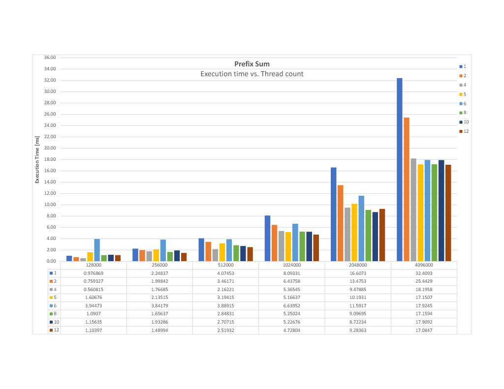
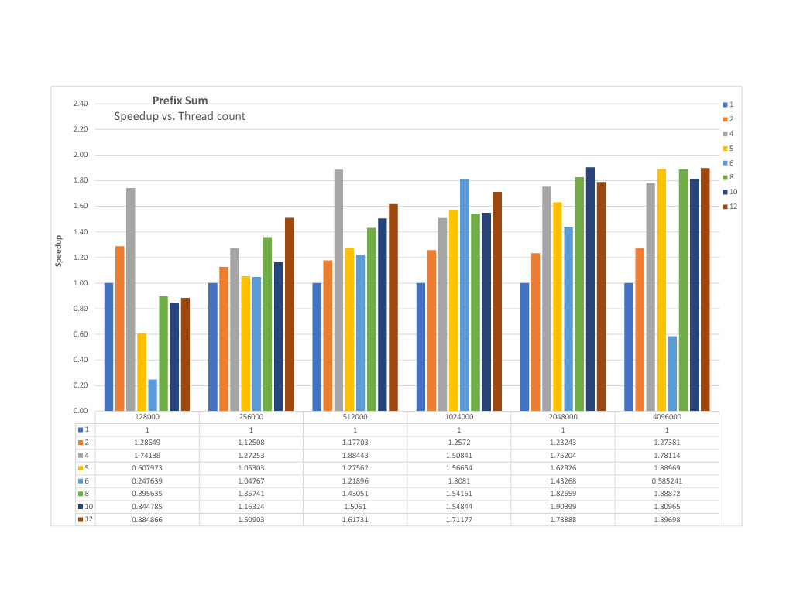

# Prefix Sum: Sequential vs. Parallel Implementation Using Pthread

## 1. Introduction

We selected the **Prefix Sum (Scan)** algorithm for this project due to its simplicity and suitability for parallel processing. Given an array of numbers, the prefix sum at position `i` is the sum of all elements up to index `i`. This algorithm is commonly used in parallel computing applications such as stream compaction, histogram generation, and cumulative sums.

### Why it's Parallelize-able

Because it depends on earlier values, the prefix sum is by nature sequential. However, we can efficiently parallelize it by splitting the input array into chunks and performing local prefix sums in parallel, followed by an offset adjustment phase. This method illustrates important parallel programming ideas like thread communication, synchronization, and work division.

### Time Measurement

Time was measured using the `std::chrono::high_resolution_clock` for precision, capturing start and end time around the function call.

## 2. Sequential Implementation

### Code Explanation

```cpp
std::vector<int> prefix_sum_sequential(const std::vector<int>& input) {
    std::vector<int> output(input.size());
    if (input.empty()) return output;

    output[0] = input[0];
    for (size_t i = 1; i < input.size(); ++i) {
        output[i] = output[i - 1] + input[i];
    }
    return output;
}
```

- We initialize the output array.
- Compute prefix sums in a single loop using the previous value.

## 3. Parallelization Approach Using OpenMP

The implementation uses a **three-phase block-based parallelization strategy** with OpenMP:

### Phase 1: Local Prefix Sum Computation

The array is divided into equal-sized blocks using `#pragma omp parallel`, where each thread computes the prefix sum within its assigned block independently. Each thread calculates its thread ID (`omp_get_thread_num()`) to determine its work boundaries and processes elements from `start` to `end` sequentially within its block. The final sum of each block is stored in the `block_sums` array for later use.

### Phase 2: Sequential Block Sum Propagation

A sequential loop computes the prefix sum of the `block_sums` array, which contains the cumulative totals needed to adjust each block's values. This step remains sequential to maintain simplicity and avoid complex synchronization, as the overhead is minimal compared to the parallel work in other phases.

### Phase 3: Global Adjustment

Another `#pragma omp parallel` region distributes threads to add the appropriate block prefix values to their respective elements. Each thread (except thread 0) adds `block_sums[tid-1]` to all elements in its block, effectively propagating the cumulative sums from previous blocks.

### Key OpenMP Features

- `omp_set_num_threads(num_threads)` controls thread count
- `#pragma omp parallel` creates parallel regions with implicit barriers
- Thread-local calculations using `omp_get_thread_num()` for work partitioning
- No explicit synchronization primitives needed due to structured parallel phases

This approach balances parallel efficiency with implementation simplicity, achieving good cache locality through block-based processing while minimizing synchronization overhead.

### Correctness Validation

Last item within the output vector must be the same as the last one in the sequential result, otherwise the result is not correct.

## 4. Experiments

### Hardware

- **CPU**: Intel Core i5-9600KF
- **Cores**: 6 Cores
- **Speed**: 4.8GHz (Fixed Overclocked across all 6 cores)
- **OS**: Ubuntu 22.04 (WSL2)

CPU Speed is not turbo boost, rather its a fixed speed at all times.

### Input Sizes and Thread Counts

- Input sizes: 128000, 256000, 512000, 1024000, 2048000, 4096000
- Threads: 1, 2, 4, 5, 6, 8, 10, 12

## 5. Results

| **Array Size** | **Threads** | **Execution Time (ms)** | **Speedup** |
| -------------- | ----------- | ----------------------- | ----------- |
| **128000**     | 1           | 0.976869                | 1           |
| **128000**     | 2           | 0.759327                | 1.28649     |
| **128000**     | 4           | 0.560815                | 1.74188     |
| **128000**     | 5           | 1.60676                 | 0.607973    |
| **128000**     | 6           | 3.94473                 | 0.247639    |
| **128000**     | 8           | 1.0907                  | 0.895635    |
| **128000**     | 10          | 1.15635                 | 0.844785    |
| **128000**     | 12          | 1.10397                 | 0.884866    |
|                |             |                         |             |
| **256000**     | 1           | 2.24837                 | 1           |
| **256000**     | 2           | 1.99842                 | 1.12508     |
| **256000**     | 4           | 1.76685                 | 1.27253     |
| **256000**     | 5           | 2.13515                 | 1.05303     |
| **256000**     | 6           | 3.84179                 | 0.585241    |
| **256000**     | 8           | 1.65637                 | 1.35741     |
| **256000**     | 10          | 1.93286                 | 1.16324     |
| **256000**     | 12          | 1.48994                 | 1.50903     |
|                |             |                         |             |
| **512000**     | 1           | 4.07453                 | 1           |
| **512000**     | 2           | 3.46171                 | 1.17703     |
| **512000**     | 4           | 2.16221                 | 1.88443     |
| **512000**     | 5           | 3.19415                 | 1.27562     |
| **512000**     | 6           | 3.88915                 | 1.04767     |
| **512000**     | 8           | 2.84831                 | 1.43051     |
| **512000**     | 10          | 2.70715                 | 1.5051      |
| **512000**     | 12          | 2.51932                 | 1.61731     |
|                |             |                         |             |
| **1024000**    | 1           | 8.09331                 | 1           |
| **1024000**    | 2           | 6.43758                 | 1.2572      |
| **1024000**    | 4           | 5.36545                 | 1.50841     |
| **1024000**    | 5           | 5.16637                 | 1.56654     |
| **1024000**    | 6           | 6.63952                 | 1.21896     |
| **1024000**    | 8           | 5.25024                 | 1.54151     |
| **1024000**    | 10          | 5.22676                 | 1.54844     |
| **1024000**    | 12          | 4.72804                 | 1.71177     |
|                |             |                         |             |
| **2048000**    | 1           | 16.6073                 | 1           |
| **2048000**    | 2           | 13.4753                 | 1.23243     |
| **2048000**    | 4           | 9.47885                 | 1.75204     |
| **2048000**    | 5           | 10.1931                 | 1.62926     |
| **2048000**    | 6           | 11.5917                 | 1.43268     |
| **2048000**    | 8           | 9.09695                 | 1.82559     |
| **2048000**    | 10          | 8.72234                 | 1.90399     |
| **2048000**    | 12          | 9.28363                 | 1.78888     |
|                |             |                         |             |
| **4096000**    | 1           | 32.4093                 | 1           |
| **4096000**    | 2           | 25.4429                 | 1.27381     |
| **4096000**    | 4           | 18.1958                 | 1.78114     |
| **4096000**    | 5           | 17.1507                 | 1.88969     |
| **4096000**    | 6           | 17.9245                 | 1.8081      |
| **4096000**    | 8           | 17.1594                 | 1.88872     |
| **4096000**    | 10          | 17.9092                 | 1.80965     |
| **4096000**    | 12          | 17.0847                 | 1.89698     |

### Graphs





## 6. Discussion

### Sublinear Speedup Causes

1. **Memory Bandwidth Saturation**: Multiple threads competing for the same memory bus create bottlenecks, especially evident in smaller arrays (128K-256K) where performance degrades significantly with 5-6 threads

2. **False Sharing and Cache Coherency Overhead**: Dramatic performance drops at certain thread counts (5-6 threads) indicate cache line invalidation costs when threads access adjacent memory locations

3. **Hardware Limitations and Oversubscription**: With a 6-core/6-thread system, performance degrades when using 5-6 threads due to resource contention and lack of hyperthreading. Using thread counts exceeding physical cores (8-12 threads) forces oversubscription, leading to context switching overhead and reduced per-thread performance

4. **Thread Management Overhead**: Poor performance at non-optimal thread counts suggests suboptimal thread-to-core mapping and increased scheduling costs, particularly evident when thread count doesn't align with the 6-core hardware topology

## 7. Conclusion

### Challenges

- **Algorithm Complexity**: Initially struggled with implementing efficient synchronization patterns; overcame by starting with simpler approaches and iteratively refining to a block-based method
- **Unexpected Performance Degradation**: Discovered that 5-6 threads performed worse than 4 threads despite having 6 cores; solved through systematic benchmarking to identify optimal thread counts
- **Memory Access Optimization**: Faced cache coherency issues and false sharing; resolved by implementing block-based partitioning to improve spatial locality and reduce contention

### Used Tools

[CSV to markdown](https://tableconvert.com/csv-to-markdown)

---

This project effectively demonstrated the contrast between sequential and parallel computing using openmp.
